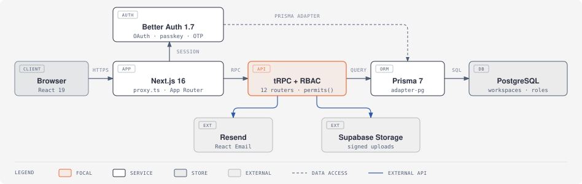

<div align="center">

# Next.js SaaS Template

Multi-tenant SaaS starter: Next.js 16, Better Auth, tRPC, Prisma and role-based access control.

[](https://github.com/Kondasamy/nextjs-saas-template/actions/workflows/ci.yml)
[](https://github.com/Kondasamy/nextjs-saas-template/releases)
[](LICENSE)

</div>



## What's included

| Area | Features |
|---|---|
| **Auth** | Email + password, Google / GitHub / Microsoft OAuth, magic links, passkeys, email OTP sign-in, active session management |
| **Workspaces** | Multi-tenant isolation, invitations and invite links, custom roles over 17 granular permissions, ownership transfer, archive and clone |
| **Admin** | User management, impersonation with audit log, maintenance mode, analytics dashboard |
| **Platform** | tRPC API with end-to-end types, API keys (SHA-256 hashed), in-app notifications, file uploads, 11 React Email templates |
| **UI** | ShadCN UI, Tailwind CSS 4, 14 built-in themes with light and dark modes |
| **Quality** | TypeScript 7, Biome, Oxlint, Playwright smoke tests, GitHub Actions CI on every PR |

## Quick start

Requires **Node 24+**, **pnpm 11** and a PostgreSQL database.

```bash
git clone https://github.com/Kondasamy/nextjs-saas-template.git
cd nextjs-saas-template
pnpm install
cp .env.local.example .env.local   # set DATABASE_URL, DIRECT_URL, BETTER_AUTH_SECRET
pnpm db:migrate
pnpm db:seed                       # optional demo data (demo@yourdomain.com / demo1234)
pnpm dev
```

Open [localhost:3000](http://localhost:3000). Email, OAuth and storage are optional and switch on when their keys are set. See [`.env.local.example`](.env.local.example) for all variables, and add your address to `ADMIN_EMAILS` for admin access.

## Scripts

| Command | Purpose |
|---|---|
| `pnpm dev` / `pnpm build` / `pnpm start` | Develop, build, serve |
| `pnpm typecheck` / `pnpm lint` / `pnpm format` | TypeScript, Oxlint, Biome |
| `pnpm test:e2e` | Playwright smoke suite against `pnpm start` (build first) |
| `pnpm test:rbac` | Ownership and permission checks against the database |
| `pnpm test:emails` | Render every email template |
| `pnpm db:migrate` / `pnpm db:studio` | Prisma migrations and studio |

## Documentation

[Getting started](docs/getting-started.md) ·
[Authentication](docs/authentication.md) ·
[RBAC](docs/rbac.md) ·
[Workspaces](docs/workspaces.md) ·
[Emails](docs/emails.md) ·
[Admin](docs/admin.md) ·
[API](docs/api.md) ·
[Architecture](docs/architecture.md) ·
[Theming](docs/theming.md) ·
[Deployment](docs/deployment.md)

**Known limitation:** 2FA can be enabled in settings but is not yet enforced at sign-in. See the [release notes](https://github.com/Kondasamy/nextjs-saas-template/releases) for other open issues.

## Contributing

Contributions are welcome. See [CONTRIBUTING.md](CONTRIBUTING.md). CI must pass before merge.

## License

[MIT](LICENSE)
