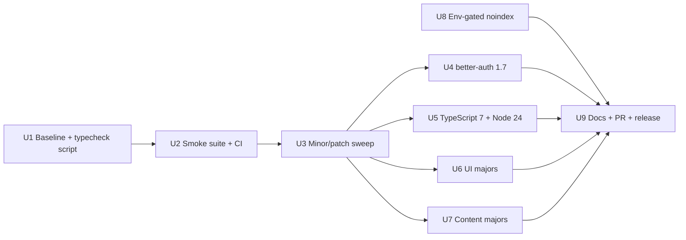

# Dependency Refresh, Smoke Tests, and Release - Plan

## Goal Capsule

- **Objective:** Bring every dependency of the published template to its current stable version (except the documented holds), prove the app still works with typecheck, lint, build and a Playwright smoke suite in CI, and publish the result as GitHub release `v0.1.0`.
- **Authority:** User scope answers (KTD1–KTD4) > this plan > repo conventions in `CLAUDE.md`.
- **Stop conditions:** Stop and surface a blocker if any upgrade, major or minor, cannot be made green without rewriting a feature. That package is pinned at its current version and held back and recorded in the release notes; the rest of the release continues. Also stop if better-auth needs a destructive data migration.
- **Execution profile:** One branch, one PR, one commit per unit. Units run in listed order, and each must be green before the next starts. Units U3–U7 each land as a separate commit so a bad upgrade can be reverted alone. Inside U3, Next and Prisma get their own commits.
- **Tail ownership:** The executor opens the PR, waits for CI to pass, merges, and creates the release (U9).

---

## Product Contract

### Summary

The template at `Kondasamy/nextjs-saas-template` is about a year behind on dependencies: 64 minor or patch bumps and 11 major bumps are pending. It has no tests and no CI. This plan refreshes every dependency, adds a smoke-test and CI gate, fixes a template-hostile `noindex` header, and ships a tagged release.

### Problem Frame

People who clone a published template inherit its dependency debt and any security fixes it is missing. better-auth alone is three minors behind. Without CI, neither the maintainer nor contributors can tell whether an upgrade broke auth, the dashboard or email rendering. `next.config.mjs` sets `typescript.ignoreBuildErrors: true`, so `pnpm build` does not catch type errors either.

### Requirements

- R1. Every dependency is on its latest stable version, except where an Implementation Unit records a reasoned hold. Pre-releases are not taken; Prisma 8 is still `rc`.
- R2. All stable major upgrades are taken and their breakages fixed in code (KTD1). The exceptions are the holds recorded in KTD6 and KTD7 and any stop-condition hold.
- R9. `/robots.txt` is reachable without signing in. Today `proxy.ts` redirects it to `/login`, so crawlers never see it. This app serves no sitemap: `app/robots.ts` points at the marketing site's `${WEBSITE_URL}/sitemap.xml`.
- R3. `pnpm typecheck`, `pnpm lint` and `pnpm build` pass on the upgraded tree.
- R4. A Playwright smoke suite covers the critical paths: public pages render, the seeded demo user signs in, the dashboard loads, and sign-out works.
- R5. GitHub Actions runs R3 and R4 on every PR and every push to `main`, against a real Postgres.
- R6. The `X-Robots-Tag: noindex, nofollow` header is sent only when an opt-in env var is set (KTD4).
- R7. Docs reflect reality: the Node version requirement, the removed Next.js 16 "Known Issues" entry (only once the build passes), and the new test and CI commands.
- R8. The release is published as a PR merged after CI passes, followed by GitHub Release `v0.1.0` with an upgrade changelog (KTD3).

### Scope Boundaries

- No new product features and no refactors beyond what an upgrade forces.
- No unit-test suite. Vitest and router-level tests are out of scope (KTD2).
- No demo deployment.

### Deferred to Follow-Up Work

- Removing `typescript.ignoreBuildErrors` from `next.config.mjs`. CI's `typecheck` gate covers the risk; flipping the flag is a separate behavior change for template users.
- Prisma 8 when it reaches stable.
- Unit and integration tests for the tRPC routers and RBAC.

### Success Criteria

- The PR's CI run is green on all three gates plus the smoke suite.
- `pnpm outdated` lists no package released before the U3 sweep date, other than the documented holds. Releases published during the work don't count.
- Release `v0.1.0` exists on GitHub and its notes list every major upgrade and every hold.

---

## Planning Contract

### Key Technical Decisions

- KTD1. Take all stable majors and fix the breakage (session-settled: user-directed — chosen over minors-only and minors-plus-low-risk-majors). Each major family is its own unit so it can be held back alone under the stop condition.
- KTD2. "Tested" means typecheck, lint and build gates plus a Playwright smoke suite in GitHub Actions (session-settled: user-directed — chosen over build-gates-only and a full unit-plus-E2E suite).
- KTD3. Publish via PR, then a tagged GitHub Release (session-settled: user-directed — chosen over pushing to `main` and over also deploying a demo).
- KTD4. Gate the noindex header on an env var (session-settled: user-directed — chosen over leaving it uncommitted or shipping it unconditionally). The header is added only when `NOINDEX=true`. The default is off, so template users stay indexable.
- KTD5. The smoke harness lands before any upgrade (U2 before U3). It proves the current tree is green first, so later failures point at the upgrade and not at the harness.
- KTD6. TypeScript 7 is taken, and `ts-prune` is removed. ts-prune imports the TypeScript JS API, which TS 7.0 does not ship until 7.1, and no script uses it. If `next build` or `tsc` cannot run under TS 7 on Next 16.4, fall back to the latest 6.x and record the hold. tsconfig is already TS-7-compatible: `moduleResolution: bundler`, no `baseUrl`, and an explicit `types: ["node"]`.
- KTD7. Node 24 LTS is the supported runtime. It goes into CI, an `engines` field (`>=24`), and the docs, and `@types/node` is pinned to `^24` to match (session-settled: user-directed — chosen over pinning Node 22 types and over taking `@types/node` 26). This is a deliberate exception to KTD1. Node 26 typings would let code compile against APIs the runtime lacks. Shiki 4 (drops Node 18) and the better-auth CLI (needs Node 22.12 or later) both work on 24.
- KTD9. If `pnpm build` with Turbopack still fails after U3, CI switches to `next build --webpack` and the release continues (session-settled: user-directed — chosen over stopping the release). The Next.js 16 Known Issues entry then stays, and the release notes mention the fallback.
- KTD8. react-email 6 is migrated fully, not mixed. `@react-email/components` is deprecated in 6, so all imports move to `react-email`.

### Research Shaping the Plan

The breaking-change survey (sources in Sources & Research) produced these per-package facts. Exposure was checked by grepping this repo:

- **lucide-react 1.x** removes brand icons. Exposed: two brand-icon imports (`Chrome`, which stands in for Google, and `Github`) in `components/auth/social-login.tsx`. Icons now default to `aria-hidden`, so icon-only buttons need an `aria-label`.
- **react-day-picker 10** removes `initialFocus`. Exposed: `components/ui/date-range-picker.tsx`. Calendar consumers: 4 files.
- **react-resizable-panels 4** renames `PanelGroup`→`Group`, `PanelResizeHandle`→`Separator` and `direction`→`orientation`, and treats bare numbers as pixels. Exposed: only the shadcn wrapper `components/ui/resizable.tsx`; no call sites outside it.
- **better-auth 1.4 → 1.7:** this repo uses only `magicLink`, `passkey` and the `twoFactor` email config. It does not use the generic-OAuth, SSO, api-key or organization plugins. Workspaces and API keys are custom Prisma models. Remaining exposure is schema drift from 1.7, which may touch the `account` table, plus passkey plugin changes.
- **Low-risk majors:** motion 14 (no `framer-motion` imports), shiki 4, marked 18 and `@hookform/resolvers` 7 (the zod resolver is unchanged; 19 import sites).
- **Next 16.4:** no source confirms the 16.0 Turbopack production-build failure is fixed. Verify with a real build before editing Known Issues.
- **oxlint 1.32 → 1.91** may enable new correctness rules. Expect lint fixes.

### High-Level Technical Design

The graph shows only the true dependencies. Execution is still sequential on one branch: U4 through U7 run in listed order, and each must be green before the next starts.

### Assumptions

- The seeded demo user (`demo@yourdomain.com`, from `prisma/seed.ts`) can sign in with email and password in a CI environment. Verified: the seed sets `emailVerified: true`.
- `/` is the protected dashboard, not a public landing page. `proxy.ts` redirects signed-out visitors to `/login`.
- The user has push rights and `gh` auth for `Kondasamy/nextjs-saas-template`.

---

## Implementation Units

### U1. Baseline and typecheck script

**Goal:** Record the current state and add an explicit typecheck command, because the build skips type errors.

**Requirements:** R3

**Dependencies:** none

**Files:** `package.json`

**Approach:**
1. Stash the uncommitted `X-Robots-Tag` change in `next.config.mjs`. U8 brings it back behind an env var, so it must not slip into an earlier commit.
2. Add a `typecheck` script that runs the TypeScript compiler with no emit.
3. Run install, typecheck, lint and build on the current tree. Record any errors that exist before the upgrade, since `ignoreBuildErrors` may have hidden some.
4. Fix every pre-existing type error in this unit so the gate starts green. If the count makes that impractical, stop and surface it. Do not weaken the gate.

**Test expectation:** none -- adds a script only; it is verified by running it.

**Verification:** All three gates pass on unchanged dependencies.

### U2. Playwright smoke suite and CI workflow

**Goal:** Build a regression net before touching dependencies (KTD5).

**Requirements:** R4, R5

**Dependencies:** U1

**Files:** `package.json`, `playwright.config.ts`, `e2e/smoke.spec.ts`, `.github/workflows/ci.yml`, `.gitignore`

**Approach:**
1. Add `@playwright/test`, a `test:e2e` script and a config. The config runs against the production server (`pnpm build && pnpm start`) so the build path is tested.
2. Write a CI workflow on Node 24 (KTD7) with pnpm caching and a Postgres service container. It runs install, Prisma generate, migrate deploy, seed, typecheck, lint, build and smoke.
3. The workflow triggers on `pull_request` and on `push` to `main`, never on `pull_request_target`. It sets top-level `permissions: contents: read`.
4. Set `BETTER_AUTH_URL` and `NEXT_PUBLIC_APP_URL` to the Playwright base URL (`http://localhost:3000`) before the build, because sign-in checks the origin. `BETTER_AUTH_SECRET` is a 32+ character dummy, and `DATABASE_URL`/`DIRECT_URL` point at the service container.
5. Call `prisma generate` and the seed directly. The `db:*` scripts wrap a `.env.local` file that CI does not have.
6. Optional integrations stay unset: Resend, OAuth and Supabase. The app already skips them when their keys are absent.

**Execution note:** Prove the suite passes on the pre-upgrade tree before U3 starts.

**Test scenarios:**
- `/login` returns 200 and renders the sign-in form. A signed-out visit to `/` redirects to `/login`.
- The demo user signs in with email and password, lands on the dashboard, and the sidebar and page header render.
- A protected dashboard route visited while signed out redirects to `/login`.
- Wrong-password sign-in shows an error and stays on `/login`.
- Signing out lands on `/login`, and the protected route redirects again.
- The `X-Robots-Tag` header is absent on `/login` when `NOINDEX` is unset (U8 adds this assertion).

**Verification:** The CI run passes on a PR containing only U1 and U2.

### U3. Minor and patch sweep

**Goal:** Take every non-major bump except better-auth and `@better-auth/passkey` (U4 handles those), including Next 16.4, Prisma 7.10.1, tRPC 11.24, React 19.3, Radix, Tailwind 4.3, zod 4.6, Biome and oxlint.

**Requirements:** R1, R3

**Dependencies:** U2

**Files:** `package.json`, `pnpm-lock.yaml`, and any files touched by lint or format fixes

**Approach:**
1. Bump within the current majors. Land Next and Prisma as their own commits so either can be reverted alone. Record the sweep date for the Success Criteria snapshot.
2. Regenerate the Prisma client.
3. Run Biome format and fix new oxlint findings. Disable a new rule in `oxlint.json` only when the fix would be a refactor, and note each disabled rule in the PR.

**Test scenarios:** the U2 smoke suite, unchanged, passes.

**Verification:** CI passes. If the Turbopack build fails, apply the KTD9 fallback and record it, because U9's Known Issues edit depends on it.

### U4. better-auth 1.7

**Goal:** Upgrade `better-auth` and `@better-auth/passkey` to 1.7.x, with any schema changes.

**Requirements:** R1, R2

**Dependencies:** U3

**Files:** `package.json`, `lib/auth/config.ts`, `lib/auth/client.ts`, `prisma/schema.prisma`, `prisma/migrations/*`

**Approach:**
1. Bump both packages.
2. Generate the better-auth schema and diff it against the auth models in `prisma/schema.prisma`.
3. Add a Prisma migration for real drift only. Before adding any unique constraint on `account`, check that it is safe on existing data.
4. Update renamed types and imports.

**Test scenarios:**
- The smoke sign-in, sign-out and redirect scenarios pass.
- Upgrade-path check, run locally and recorded in the PR. Run migrate deploy and the seed on the pre-U4 commit. Then check out U4, run migrate deploy, and confirm the user, account and session row counts are unchanged and the demo user still signs in. CI only migrates an empty database, so this is the only check that covers existing data.
- Magic-link and passkey endpoints exist: the auth API route answers their paths without a 404. They are not exercised end to end.

**Verification:** CI passes, and the migration applies cleanly on the CI Postgres.

### U5. TypeScript 7 and the Node 24 baseline

**Goal:** Move to TS 7 (KTD6) and declare Node 24 (KTD7).

**Requirements:** R1, R2, R7

**Dependencies:** U3

**Files:** `package.json`, `tsconfig.json`

**Approach:**
1. Bump `typescript` to 7 and remove `ts-prune`.
2. Pin `@types/node` to `^24`.
3. Add `engines.node` as `>=24`, and add an `.nvmrc` containing `24` for local parity.
4. Fix any new strictness errors, such as `noUncheckedSideEffectImports` hits on CSS imports.

**Execution note:** Start with a quick probe: install TS 7 and run `next build`. Next may depend on the TypeScript JS API, which TS 7.0 lacks for the same reason ts-prune breaks. If `next build` cannot run its type step under TS 7, fall back to the latest TS 6.x and record the hold. Do not patch around it.

**Test expectation:** none -- tooling change; the typecheck, build and smoke gates verify it.

**Verification:** CI passes with `tsc --version` reporting 7.x, or the hold is recorded.

### U6. UI majors

**Goal:** Take lucide-react 1.x (1.0.1 or later), motion 14, react-day-picker 10 and react-resizable-panels 4.

**Requirements:** R1, R2

**Dependencies:** U3

**Files:** `package.json`, `components/auth/social-login.tsx`, `components/ui/resizable.tsx`, `components/ui/calendar.tsx`, `components/ui/date-range-picker.tsx`, plus icon-only buttons found by the a11y sweep

**Approach:**
1. Replace both removed brand icons in `social-login.tsx` (`Chrome` for Google, and `Github`) with inline SVG logos marked `aria-hidden`. The button text supplies the accessible name.
2. Re-pull the shadcn `resizable` component for the v4 API and keep its export names, so consumers do not change.
3. Replace `initialFocus` with `autoFocus`. Re-pull or adjust `calendar.tsx` only if its class names broke.
4. Add an `aria-label` to icon-only buttons that relied on the lucide icon's accessible name.

**Test scenarios:**
- The smoke suite passes.
- Add a check that `/login` renders each social provider button with a visible logo and an accessible name.
- Manual check: the date-range picker opens, focuses and selects a range; resizable panels drag (no current app usage, so this is a component-level check only).

**Verification:** CI passes, and the manual checks are listed as done in the PR.

### U7. Content majors

**Goal:** Take react-email 6 (KTD8), shiki 4, marked 18 and `@hookform/resolvers` 7.

**Requirements:** R1, R2

**Dependencies:** U3

**Files:** `package.json`, `emails/*.tsx`, `emails/components/*`, `lib/email/*`, `app/api/email/preview/route.ts`, `components/ui/code-block.tsx`, `components/ui/markdown.tsx`, `scripts/render-emails.ts`, `.github/workflows/ci.yml`

**Approach:**
1. Remove `@react-email/components` and move every import to `react-email`.
2. Add `@react-email/ui` only if the preview dev server is used.
3. Bump shiki, marked and the resolvers, and fix any type fallout.

**Test scenarios:**
- A small `tsx` script imports each of the 11 templates in `emails/` and renders it with `react-email`'s `render`. It exits non-zero if any template throws or renders empty HTML. CI runs it after the build. This is a single render check, not a test framework.
- `/api/email/preview` is not used for this check. It returns 404 in production on purpose and covers only 6 templates. Its production guard must not be changed to make a test pass.
- A settings form submitted with an invalid value shows the zod validation message, which proves the resolver.

**Verification:** CI passes, and all templates render.

### U8. Crawler controls: env-gated noindex and public robots.txt

**Goal:** Ship the uncommitted `X-Robots-Tag` change safely (KTD4), and make `/robots.txt` reachable for crawlers.

**Requirements:** R6, R9

**Dependencies:** U2 (creates `e2e/smoke.spec.ts`)

**Files:** `next.config.mjs`, `proxy.ts`, `.env.local.example`, `.gitignore`, `docs/deployment.md`, `e2e/smoke.spec.ts`

**Approach:**
1. Restore the stashed change, and include the header in `headers()` only when `process.env.NOINDEX === 'true'`.
2. Document `NOINDEX` as an optional build-time variable in the env example and the deployment doc. Next reads `headers()` when `pnpm build` runs, so setting it only at runtime has no effect.
3. `.gitignore` currently excludes `.env*`, so the example file has never shipped. Add a `!.env.local.example` negation, check the file holds no secrets, and commit it.
4. Add `robots.txt` to the exclusion pattern in the `proxy.ts` matcher, next to the existing `favicon.ico` exclusion. Do not add it to `publicRoutes`.

**Test scenarios:**
- With `NOINDEX` unset, the response has no `X-Robots-Tag`.
- A signed-out request to `/robots.txt` with `maxRedirects: 0` returns 200 with plain-text content containing `User-Agent` and `Sitemap:` lines.
- A signed-out visit to `/` still redirects to `/login`, so the matcher change didn't widen public access.
- With `NOINDEX=true` at build time, the header is `noindex, nofollow`. Test this manually; adding a second CI build is not worth the time.

**Verification:** The smoke assertion passes, and the manual check is noted in the PR.

### U9. Docs, version, PR and release

**Goal:** Publish (KTD3).

**Requirements:** R7, R8

**Dependencies:** U4, U5, U6, U7, U8

**Files:** `README.md`, `CLAUDE.md`, `docs/getting-started.md`, `CONTRIBUTING.md`, `package.json`

**Approach:**
1. Change "Node 18+" to "Node 24+".
2. Add the `typecheck` and `test:e2e` commands.
3. Remove the Next.js 16 Known Issues entry from `README.md` and `CLAUDE.md` only if the Turbopack build passed. If the KTD9 fallback was used, keep the entry and update it to name the webpack fallback.
4. Bump the version to `0.1.0`.
5. Run `pnpm audit --prod`. Fix advisories that a patch release resolves, and list any that remain.
6. Draft the release notes, which go in the GitHub Release body only (no `CHANGELOG.md` file). List the major upgrades, the holds and their reasons, any remaining audit advisories, the new CI, `NOINDEX`, the robots.txt fix, and the Node 24 requirement.
6. Open the PR, wait for CI to pass, merge, tag `v0.1.0`, and create a GitHub Release from the changelog entry.

**Test expectation:** none -- docs and release.

**Verification:** Release `v0.1.0` is visible on GitHub, and `main`'s CI is green.

---

## Verification Contract

- Gates, all required on the PR: `pnpm typecheck`, `pnpm lint`, `pnpm build`, the email render script, and `pnpm test:e2e`, running in `.github/workflows/ci.yml` on Node 24 with Postgres.
- Each upgrade unit (U3–U7) must leave all gates green before the next starts.
- `pnpm outdated` after U7 shows only the documented holds: `@types/node` held at 24 (KTD7), Prisma 8 RC, and any KTD6 or stop-condition fallbacks.
- `pnpm audit --prod` runs before release, and any remaining advisories appear in the release notes.

## Definition of Done

- R1–R9 are satisfied, and every hold is listed with a reason in the release notes.
- CI is green on `main` after merge.
- No leftover experiment code: abandoned upgrade attempts, commented-out imports, or stray oxlint disables without a PR note.

---

## Sources & Research

- Lucide v1: https://lucide.dev/guide/version-1
- react-resizable-panels 4 and shadcn resizable: https://ui.shadcn.com/docs/components/radix/resizable
- React Email 6: https://resend.com/blog/react-email-6
- Better Auth 1.7 upgrade guide: https://better-auth.com/docs/guides/1-7-upgrade-guide
- TypeScript 7: https://devblogs.microsoft.com/typescript/announcing-typescript-7-0/
- Next.js TypeScript config: https://nextjs.org/docs/app/api-reference/config/typescript
- Shiki v4: https://shiki.style/blog/v4
- Prisma 7.10.0: https://github.com/prisma/orm/releases/tag/7.10.0
- Not verified: official Next 16.4 notes, the full oxlint rule diff, and shadcn's stance on react-day-picker v10. Each is covered by an execution-time gate.
